<table>
  <tr>
    <td width="68%" valign="middle">
      
CYBERSECURITY · DIGITAL FORENSICS · SOC

      <h1>OM AWACHAT</h1>
      
<em>Investigate with curiosity. Defend with evidence.</em>

      
DFIR / SOC / THREAT INTELLIGENCE / INCIDENT RESPONSE

      
<a href="https://omawachat07.github.io/omawachat07/">PORTFOLIO</a> · <a href="https://github.com/omawachat07">GITHUB</a> · <a href="https://www.linkedin.com/in/om-awachat/">LINKEDIN</a>

    </td>
    <td width="32%" align="center" valign="middle">
      
    </td>
  </tr>
</table>

  
  
  
  



I build **defensive cybersecurity tools** with an emphasis on evidence, explainability and local-first workflows. My work spans **detection engineering, digital forensics, phishing investigation, cloud security, threat intelligence and LLM application security**. I’m especially interested in turning complex security signals into clear investigations and useful analyst workflows.


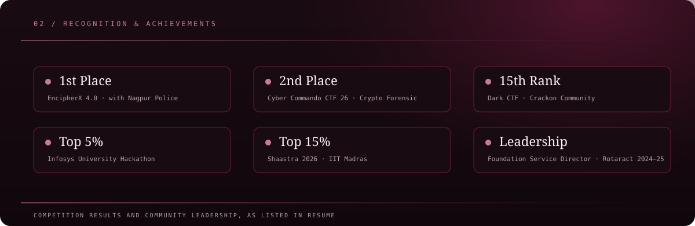


The projects below are maintained in **private GitHub repositories**. Their source code is not public, but the summaries show the engineering problems and capabilities behind each build.

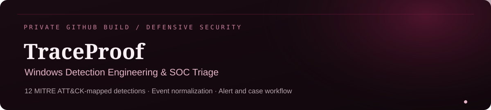

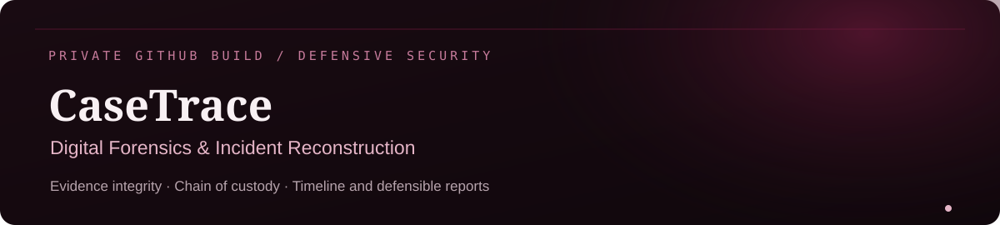


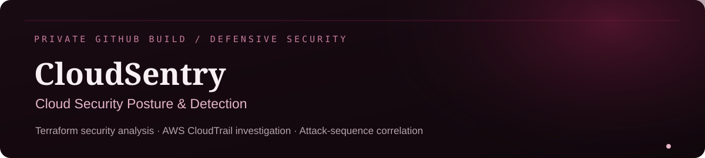

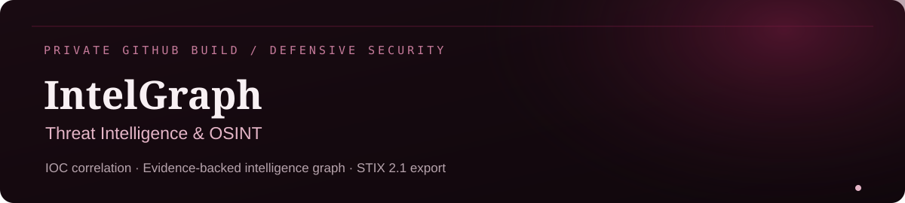

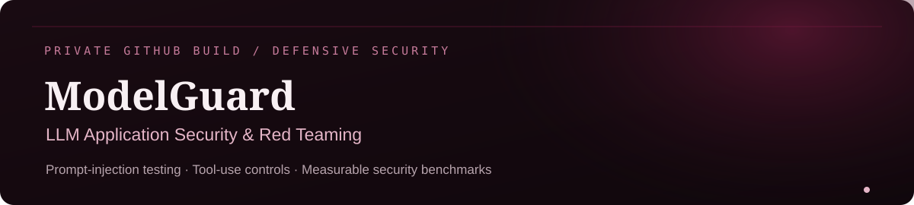


**Cyber Security Intern — Gurugram Police (GPCSSI26)** · *June–July 2026*  
Exposure to cybercrime investigations, DFIR procedures, evidence analysis, IPDR analysis and investigative methods.

**Penetration Testing Intern — Hacktify CyberSecurity** · *March–April 2025*  
Practised OWASP Top 10 assessments and web security testing, including SQL injection and cross-site scripting.

**Cyber Security Intern — ShadowFox** · *February–March 2025*  
Worked on vulnerability assessment, network reconnaissance, traffic analysis and directory enumeration in practical labs.

**ServiceNow Virtual Intern — ServiceNow University / SmartBridge** · *September–October 2025*  
Worked with ServiceNow Administration, Flow Designer, Automated Test Framework and ITSM workflows.

**Cyber Security Intern — InternsUP** · *June–August 2023*  
Worked on network scanning, reconnaissance, vulnerability assessment, threat analysis and incident-response simulations.



  


If you work on **defensive security, DFIR, detection engineering or security tooling**, I’d be glad to connect.

  
  

