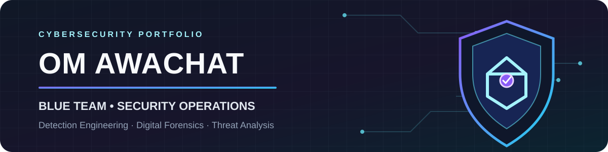

<!--
  Om Awachat | Cybersecurity Profile
  Profile README for github.com/omawachat07
-->

  

<h1 align="center">OM AWACHAT</h1>
<h3 align="center">Cybersecurity Analyst · DFIR · SOC Operations · Threat Intelligence</h3>

  
  
  

---

## 01 · About me

I'm an aspiring **Cybersecurity Professional** with practical exposure to digital forensics and incident response (DFIR), SOC operations, malware analysis, reverse engineering, and vulnerability assessment.

I enjoy investigating security events, understanding attacker techniques, and building practical security workflows. My hands-on learning includes **Splunk, Ghidra, Wireshark, Python, Linux, network analysis, and cybersecurity labs**. I am also exploring cloud security and AI-enabled threat intelligence.

- 🔎 Interested in **SOC, DFIR, Threat Detection, Incident Response, and OSINT**
- 🛡️ Learning through internships, CTFs, practical labs, and security projects
- 🧠 Focused on evidence-led analysis, clear documentation, and continuous learning
- 📍 Nagpur, Maharashtra, India

## 02 · Areas of expertise

  
  
  
  
  
  
  
  
  
  
  

## 03 · Technical toolkit

**Security & analysis**

  
  
  
  
  

**Programming, operating systems & networking**

  
  
  
  
  
  

**Other skills:** Packet analysis · Disk and memory forensics · Email header analysis · Vulnerability assessment · Dynamic and static malware analysis · Google Dorking · Routing and switching

## 04 · Experience

| Role | Organization | Period |
|---|---|---|
| Cyber Security Intern | Gurugram Police (GPCSSI26) | Jun 2026 – Jul 2026 |
| Cyber Security Intern | ShadowFox | Feb 2025 – Mar 2025 |
| Penetration Testing Intern | Hacktify CyberSecurity | Mar 2025 – Apr 2025 |
| ServiceNow Virtual Internship | ServiceNow University / SmartBridge | Sep 2025 – Oct 2025 |
| Admissions Assistant | Parul University | Apr 2024 – Jun 2024 |
| Cyber Security Intern | InternsUP | Jun 2023 – Aug 2023 |

**Highlights:** Cybercrime investigation exposure, IPDR and tower-location-data analysis, vulnerability assessment, network reconnaissance, web security testing, traffic analysis, directory enumeration, malware-analysis labs, ServiceNow administration, and workflow training.

## 05 · Featured projects

### 🕵️ AI-Powered Dark Web Threat Intelligence Platform
A cybersecurity intelligence platform using Tor, NLP, and graph analytics to collect, analyze, and correlate dark-web threat intelligence.

- Threat-actor profiling and automated threat classification
- Supports proactive cyber threat detection

### 🤖 AEGIS V3 — AI Red Teaming & Security Assessment Platform
An AI-powered red-teaming platform for automated LLM security testing and adversarial attack simulation.

- Vulnerability assessment and reporting workflows
- Evaluates model resilience against prompt-injection and jailbreak attacks

### 📊 SIEM Threat Detection Platform
A security monitoring project focused on practical SOC detection and incident analysis.

- Custom Splunk correlation rules and real-time monitoring dashboards
- Log-correlation and alerting workflows aligned with SOC operations and MITRE ATT&CK

## 06 · Certifications & learning

- Certified Ethical Hacking (CEH v13) — EC-Council *(Pursuing)*
- Certified Red Team Analyst (CRTA) — Cyberwarfare *(Pursuing)*
- ISO/IEC 27001:2022 · ISO/IEC 27701:2025 · ISO/IEC 42001:2023 Lead Auditor — MASTERMIND
- Certified Social Engineering Defense Practitioner (CSEDP) — TheSecOps Group
- Digital Personal Data Protection Act 2023 — DPDPA.com
- Zero Trust Cyber Associate (ZTCA) — Zscaler Inc
- Certified BlueTeam Practitioner (CBTP) — TheSecOps Group
- Certificate Ransomware Protection Officer (CRPO) — EU Cyber Academy

## 07 · Achievements

- 🥇 **1st Place** — EncipherX 4.0, in collaboration with Nagpur Police (St. Vincent Pallotti College)
- 🥈 **2nd Place** — Cyber Commando CTF 26 (Crypto Forensic Technology)
- **15th Rank** — Dark CTF (Crackon Community)
- **Top 5%** — Infosys University Hackathon (Synchrony & Cybersecurity Centre of Excellence)
- **Top 15%** — Shaastra 2026 (IIT Madras)
- **Foundation Service Director** — Rotaract Club of Parul University (2024–2025)

## 08 · Education

**B.Tech — Cyber Security**  
Parul University, Vadodara, Gujarat · *July 2023 – May 2027*

**Higher Secondary Education (12th)**  
St. Paul Junior College, Nagpur, Maharashtra · *June 2022 – May 2023*

**Secondary School Education (10th)**  
Reliance Foundation School, Nagpur, Maharashtra · *June 2020 – July 2021*

## 09 · Beyond cybersecurity

- **Languages:** English, Hindi, Marathi, Gujarati
- **Strengths:** Communication, analytical thinking, problem-solving, critical thinking, attention to detail, ethical mindset, teamwork, time management, and leadership
- **Activities:** Cultural event management, volunteering, community meetups, and cybersecurity workshops

---

## Let's connect

  
  
  

<i>“Investigate with curiosity. Defend with evidence. Build with purpose.”</i>

