  
  
  

I’m **Om Awachat**, a cybersecurity practitioner interested in building practical defensive tools. My work sits at the intersection of **digital forensics, detection engineering, threat intelligence, cloud security and AI application security**. I care about evidence-led analysis, clear technical reasoning and security workflows that are useful beyond a demo.

The projects below are developed in **private GitHub repositories**. Their summaries are shown here to communicate the engineering focus; the source code is not publicly accessible.

**Security domains**

Detection engineering · SOC triage · DFIR · Email security · Threat intelligence · OSINT · Cloud security · Static analysis · LLM red teaming

**Technologies used across these builds**

Python · FastAPI · SQLite · React · TypeScript · Windows Event Logs · MITRE ATT&CK · STIX 2.1 · Terraform · AWS CloudTrail · NetworkX

I’m open to connecting with security practitioners, engineers and teams working on defensive security, digital investigations and security tooling.

  
  

